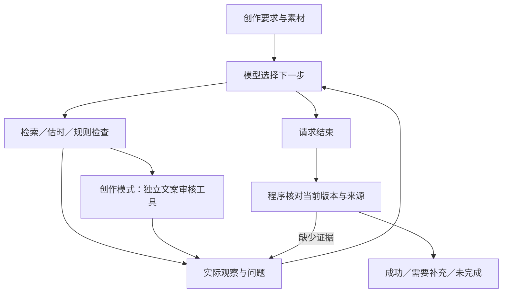

# 项目阅读与本人复核导读

本页帮助提交者理解实现和实际证据，不代表提交者已经完成这些操作。本人复核和学习心得应在实际操作后追加到 AI 使用说明。

## 1. 先理解一次任务

用户给出“面向新手、抖音、30 秒、自然风格”的要求。Agent 先决定查什么资料；工具返回实际事实；模型据此写稿并选择估时、检查；检查发现问题后，模型收到问题位置和原因，再决定修改或结束。



程序不按“检索失败就固定重试”安排业务分支。可以检查 `agent.py` 的循环：它先调用模型，再执行模型选择的工具，将实际观察发回模型。循环外的输入校验、执行上限及最终成功条件属于程序约束。

## 2. 最值得解释的五个取舍

**为什么不能只给脚本加一个 P01？** P01 只有“支持字幕”，不能证明自动识别或效率数字。引用 ID、事实原句和对应分镜必须一致，自由文案还要检查是否扩大原意。

**为什么改一个字也可能要重新检查？** 修改字幕可能改变时长、含义或品牌规则。程序管理修订号并清除旧检查，最后两项检查必须对应同一内容指纹。不能使用第一稿的通过结果为第二稿背书。

**为什么不相信模型自己说“28 秒”？** 模型自报数字不稳定。时长工具根据文字、字幕、画面预算和停顿重新计算，最终输出取工具值。规则估时仍有误差，实际配音可能不同。

**为什么增加创作模式？** 旧白名单误拦安全表达。创作模式允许自然开场和拍摄建议，代价是增加模型审核和语义误判风险。实际漏放“无需重剪”后补上确定性来源检查，说明模型审核也需要回归反例。

**为什么审核器不是第二个 Agent？** 它只接收固定审核数据、返回逐字段结论，没有规划、选择工具或结束任务权限。业务 Agent 决定后续动作；程序决定是否有足够证据接受成功。

相关代码：[循环和版本管理](../src/shortvideo_agent/agent.py)、[确定性工具](../src/shortvideo_agent/tools.py)、[创作审核](../src/shortvideo_agent/grounding.py)、[离线证据审计](../src/shortvideo_agent/evaluation.py)。

## 3. 亲自复核的建议顺序

在仓库根目录执行，不需要模型密钥：

```powershell
python -m src.shortvideo_agent evaluate
python -W error::ResourceWarning -m unittest discover -s tests -v
python -m src.shortvideo_agent inspect --input examples/inputs/missing_duration.json
```

前两条应全部通过；第三条按预期返回缺少目标时长以及退出码 2，不能把它误判为程序崩溃。然后阅读 [抖音最终稿](../examples/phase06/creative-douyin-final/script.md)，逐镜核对引用及时间之和。

再打开 [语义修正 Trace](../examples/phase06/creative-semantic-repair-valid/trace.json)，找到事件 6 的实际驳回，接着找到后续模型响应、新修订与最终检查。对照 [旧漏检样本](../examples/phase06/creative-douyin-compact/script.md)，判断“手动改字幕”为什么不能证明“无需重剪”。

若需要查看实时模型行为，运行 README 中的真实生成命令。它会消耗 API 额度，创建新的运行目录；输出、耗时与轮数可能改变。

## 4. 如何写真实个人记录

完成操作后，可按下面的事实项记录：日期和用时、执行命令、实际返回、阅读的 Trace 事件、发现的问题、你作出的取舍或修改、修改后的复验结果。没有修改源码时可以如实记录阅读和验证，不要求为了填记录而改代码。

个人心得可以围绕具体证据展开，例如说明这次观察如何改变了你对“有引用就可信”“工具报错与检查不通过”“模型输出成功就算完成”的理解。记录应反映本人实际理解；本页未预填第一人称经历。
